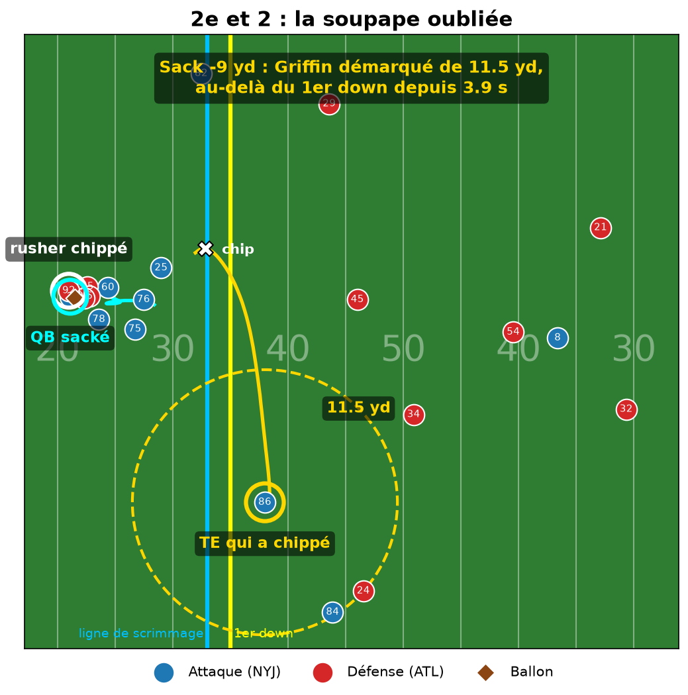

# Le chip oublié : le TE/RB qui chippe est une soupape anti-sack

Nous avons analysé, action par action, les TE et RB qui donnent un coup (« chip ») à un pass rusher avant de partir en
route (`pff_blockType == "CH"`) : à partir du tracking NGS, nous mesurons leur profondeur, leur séparation au défenseur
en couverture le plus proche et depuis combien de temps ils sont démarqués au moment où le QB lance ou se fait sacker,
puis un modèle de complétion (entraîné sur les semaines 1-6, calibré sur les semaines 7-8) donne la valeur de chaque option.
En temps normal, les QB ont raison de l'ignorer : sur 928 passes où il n'est pas ciblé, l'option choisie valait
4,0 yards attendus de plus (IC95 : 3,7 à 4,3).
Mais sur 88 sacks avec chip, le TE/RB qui avait chippé était démarqué (≥ 3 yd) au-delà de la ligne depuis au moins
1 seconde dans 36 cas (36 % des joueurs, contre 23 % pour les autres receveurs à profondeur égale), alors que chaque
sack a coûté 7,4 yards en moyenne.
Pour un coach de QB, c'est une règle de progression : quand rien n'est ouvert vers 3 secondes, lâcher le ballon au
joueur qui a chippé plutôt que de le garder (NGS mesure 80,2 % de réception sur ces passes ; nous trouvons 82 %,
IC95 76-88 %).
Limites : modèle simple (profondeur + séparation, sans la vitesse de retour du défenseur ni la visibilité du QB sous
pression), 8 semaines de 2021 et 88 sacks ; comparé aux autres receveurs des mêmes actions (plus profonds), l'écart se
réduit (36 % contre 30 %) et n'est plus significatif.




Animation de cette action : `chip_sack.html` (à télécharger puis ouvrir dans un navigateur).

## Comment lancer

```bash
pip install -r requirements.txt
python src/build_tables.py    # tables communes -> outputs/chips.csv, outputs/edge_rushers.csv (~30 s)
python decision.py            # décision du QB, lit outputs/chips.csv (~1 min) -> decision.parquet, duel.parquet
python coach.py               # rusher visé (même rusher) et action à situation égale
python chart.py               # graphique phare -> insight.png
python animate_sack.py        # animation d'un sack avec chip -> chip_sack.html / chip_sack.png
python analysis/mecanique.py  # type et durée du chip -> figures/A_*.png, results/A.md
```
