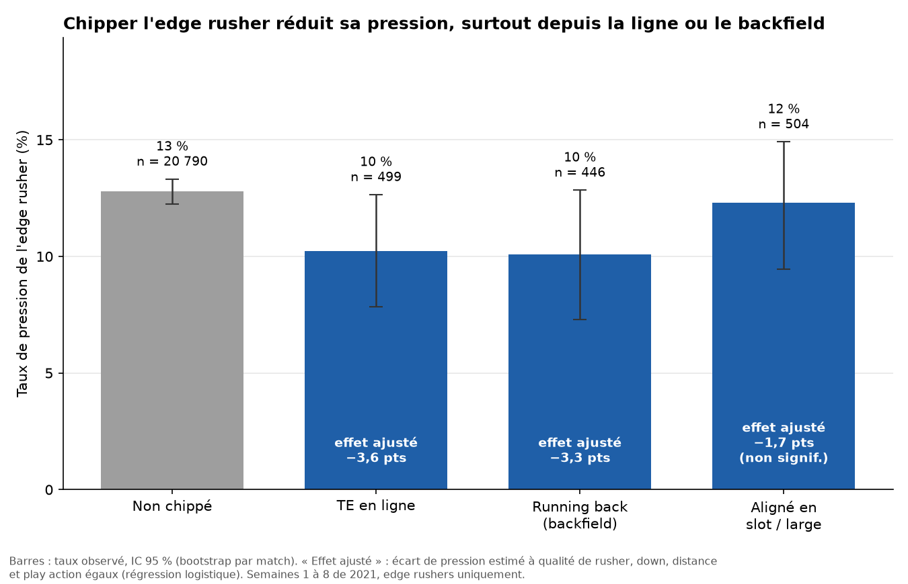
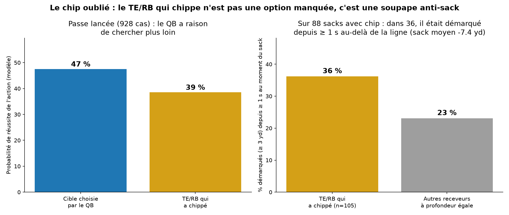

# Le chip du TE et du RB : moins de pression, et une option à 3 secondes

Le chip, c'est quand un TE ou un RB bouscule un pass rusher avant de partir en route : nous l'avons mesuré avec le tracking NGS et les données PFF.
Il fait baisser la pression de ce rusher (-26 % avec un TE en ligne), mais n'évite pas les sacks : la pression vient alors d'un autre défenseur.
Notre conseil au coach de QB : vers 3 secondes, regarder le joueur qui a chippé, car il était libre dans 36 des 88 sacks avec chip.
Limites : 8 semaines de 2021, et l'appel de jeu est inconnu.

**Démo en ligne de l'outil « Chip Advisor » : https://chip-advisor-rouge.vercel.app**




## Comment lancer

```bash
pip install -r requirements.txt
python src/build_tables.py && python analysis/mecanique.py && python decision.py && python coach.py && python chart.py
python app/server.py          # Chip Advisor en local : http://localhost:8000
```

Le briefing du coach appelle Mistral : mettre `MISTRAL_API_KEY=...` dans un fichier `.env` à la racine (ignoré par git).
Pour redéployer la démo : `python app/export_static.py && npx vercel deploy --prod --cwd app`.
