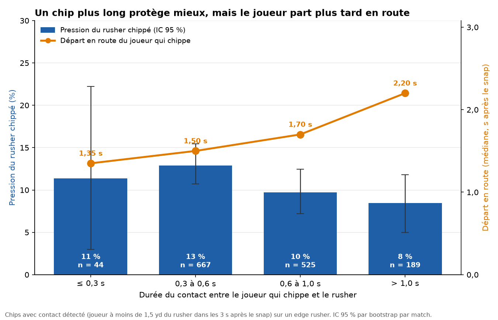

# Le chip : du rusher visé à la décision du QB

À partir du tracking Next Gen Stats et des étiquettes PFF (8 semaines de 2021), nous avons mesuré le bilan complet du **chip**, ce coup qu'un **TE ou un RB** donne à un pass rusher avant de partir en route, et nous en avons tiré un outil de décision, « Chip Advisor », pour le coordinateur offensif et le coach de QB.
Le chip protège quand il vient de la ligne ou du backfield : avec un TE en ligne, la pression de l'edge rusher visé baisse de 3,6 points (-26 %), alors qu'un joueur aligné en slot ou large ne la réduit pas de façon significative, et un contact de plus d'une seconde la fait passer de 12,9 % à 8,5 % mais retarde la sortie en route de 1,50 s à 2,20 s.
La pression ne disparaît pas pour autant : elle se reporte sur les autres rushers (+27 % à situation égale), et l'action ne finit pas significativement plus souvent en sack (8,4 % contre 6,7 %).
D'où la règle pour le QB : en temps normal, il a raison de chercher plus loin (sa cible vaut 4,0 yards attendus de plus que le joueur qui a chippé), mais vers 3 s, ce joueur est sa soupape anti-sack, démarqué depuis au moins une seconde dans 36 des 88 sacks avec chip, alors que chaque sack coûte 7,4 yards.
Méthode et limites : comparaison du même rusher chippé ou non, régressions logistiques et comparaison à situation égale (down, distance, nombre de rushers) avec intervalles de confiance par bootstrap, modèle de complétion qui retrouve le taux publié par NGS (82 % de réception après un chip, contre 80,2 %) ; l'appel de jeu est inconnu, donc le choix de chipper peut être biaisé, et les échantillons restent petits (88 sacks).





Animation de cette action : `chip_sack.html` (à télécharger puis ouvrir dans un navigateur). Chiffres détaillés et leurs sources : `results/A.md`, `results/B.md`.

## Comment lancer

Les données du défi sont dans `data/`. Python 3.10 ou plus :

```bash
pip install -r requirements.txt
python src/build_tables.py    # tables communes -> outputs/chips.csv, outputs/edge_rushers.csv (~30 s)
python analysis/mecanique.py  # type et durée du chip -> figures/A_*.png, results/A.md
python decision.py            # décision du QB (~1 min) -> decision.parquet, duel.parquet
python coach.py               # même rusher, et action à situation égale
python chart.py               # graphique de la décision du QB -> insight.png
python animate_sack.py        # animation d'un sack avec chip -> chip_sack.html, chip_sack.png
streamlit run app/advisor.py  # outil interactif « Chip Advisor »
```
